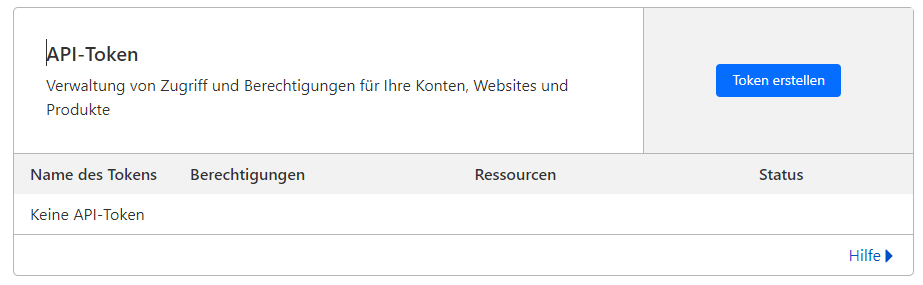
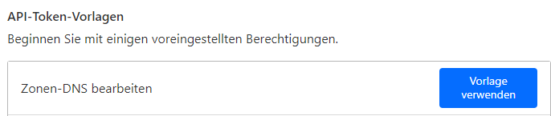
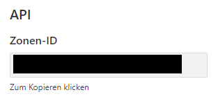
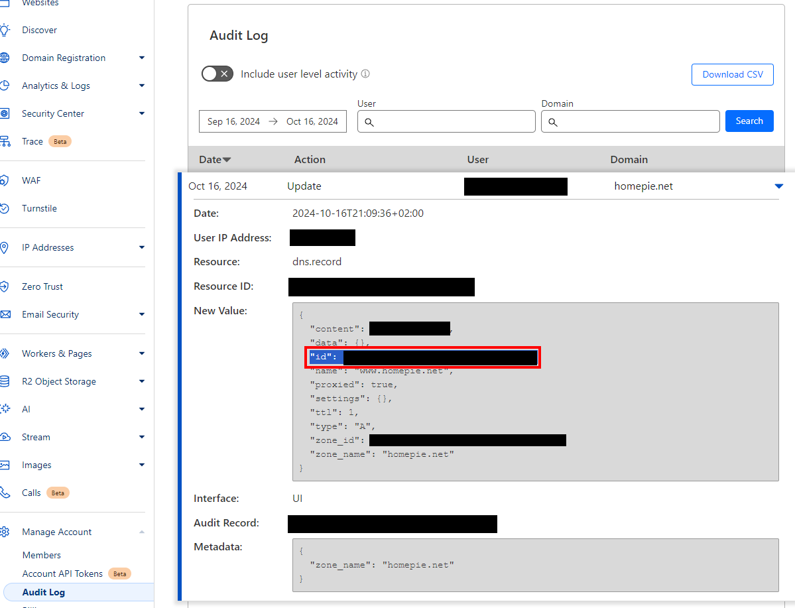

<a name="readme-top"></a>

<!-- PROJECT LOGO -->
<br />
<div align="center">
  <a href="https://github.com/arsonite/homepie">
    
  </a>

<h1 align="center">homepie</h3>
  <p align="center">
    This is the platform that powers all of my self-hosted web-apps
    <br />
    ·
    <a href="https://github.com/arsonite/homepie/issues">Report Bug</a>
    ·
    <a href="https://github.com/arsonite/homepie/issues">Request Feature</a>
  </p>
</div>

<!-- TABLE OF CONTENTS -->
<summary>Table of Contents</summary>
<ol>
  <li><a href="#deployment">Deployment</a></li>
  <li><a href="#troubleshooting-homepienet-is-not-reachable">Troubleshooting: homepie.net is not reachable</a></li>
  <li><a href="#contributing">Contributing</a></li>
  <li><a href="#license">License</a></li>
  <li><a href="#contact">Contact</a></li>
</ol>

<p align="right">(<a href="#readme-top">back to top</a>)</p>

### Built With

-   [![React][React.js]][React-url]
-   [![TypeScript][TypeScript]][TypeScript-url]
-   [![Redis][redis]][redis-url]
-   [![Celery][celery]][celery-url]
-   nginx (reverse proxy), Cloudflare (DNS), Let's Encrypt (TLS)

<p align="right">(<a href="#readme-top">back to top</a>)</p>

<!-- DEPLOYMENT -->

## Deployment

homepie runs on a single Ubuntu 22.04 home server (`192.168.2.134`). The domain `homepie.net` is registered at
Namecheap, its DNS is managed by Cloudflare.

```
browser ──► homepie.net / *.homepie.net
              │  DNS (Cloudflare)  A records ──► public IP of the home router (kept current by homepie-ddns)
              ▼
          router: TCP 80 + 443 forwarded to 192.168.2.134
              ▼
          nginx on the server (443, wildcard Let's Encrypt certificate)
              ├─ homepie.net            static landing page (client/build) + /api ──► 127.0.0.1:8888
              ├─ lockkliye.homepie.net  ──► 127.0.0.1:8101
              └─ <app>.homepie.net      ──► whatever is registered in nginx/conf.d/00-homepie-apps.conf
```

Everything below is scripted. The scripts live in [`cli/build-scripts`](cli/build-scripts), the files they install
in [`cli/build-files`](cli/build-files) and [`nginx`](nginx).

### 1. Domain: Namecheap → Cloudflare

1. Add `homepie.net` as a site in Cloudflare (Free plan). Cloudflare shows the two nameservers it assigned to the
   account.
2. In Namecheap open **Domain List → Manage → Nameservers**, select **Custom DNS** and enter exactly those two
   nameservers (for this account `luke.ns.cloudflare.com` and `rachel.ns.cloudflare.com`).
   Disable DNSSEC at Namecheap if it is enabled.


3. Wait until Cloudflare shows the site as **Active** (usually minutes, up to 24 h). From then on **Namecheap
   does not serve any DNS records for the domain anymore**: Namecheap's URL redirect, parking page and its Dynamic DNS
   feature are all ineffective. Every DNS change is done in Cloudflare.

### 2. Cloudflare API token

One token is used for everything that talks to Cloudflare: updating the A records when the public IP changes and
solving the DNS challenge for the wildcard certificate.

1. Cloudflare dashboard → **My Profile → API Tokens → Create Token**.



2. Use the template **Edit zone DNS**.



3. Permissions: `Zone` · `DNS` · `Edit`. Zone resources: `Include` · `Specific zone` · `homepie.net`. Leave the rest
   as is and create the token.


4. Store it on the server (the script verifies it first and writes `/etc/homepie/cloudflare.ini`, mode 600, owned by
   root):

```bash
cli/build-scripts/setup-cloudflare-credentials
```

> The token never belongs into the repository, a `.env` file or the shell history. Revoke it in Cloudflare if it ever
> leaks.

The zone ID and the record IDs are looked up through the API by the scripts. If you ever need them manually: the
**Zone ID** is on the **Overview** page of the domain (right column, "API"), the **record ID** is in
**Manage Account → Audit Log** (the `id` in the "New Value" of a DNS record change).




### 3. Server network

-   **Static IP**: [`cli/build-files/99_config.yaml`](cli/build-files/99_config.yaml) pins the server to
    `192.168.2.134/24` (`cli/build-scripts/modify-netplan`). The router's port forwarding must target exactly this
    address.
-   **Router port forwarding**: forward **TCP 80 and TCP 443** to `192.168.2.134` (80 only redirects to https).
    Do _not_ forward 22 (SSH) or any app port.
-   **Firewall**: `install-nginx` runs `ufw allow 'Nginx Full'` if `ufw` is active.
-   **fail2ban** (optional): `cli/build-scripts/install-fail2ban`.

### 4. Dynamic IP → Cloudflare DNS

The ISP changes the public IP from time to time, so a systemd timer runs
[`homepie-cloudflare-ddns`](cli/build-files/cloudflare-ddns) every 5 minutes. It keeps the A records `homepie.net` and
`*.homepie.net` on the current public IPv4 address and creates them if they do not exist (additional names via
`HOMEPIE_DDNS_RECORDS`).

```bash
cli/build-scripts/setup-periodic-cloudflare-ddns
sudo journalctl -u homepie-ddns.service -n 20   # check what it did
```

This replaces the former `ddclient` + Namecheap Dynamic DNS setup (`install-ddclient`), which stops working as soon
as the nameservers point to Cloudflare. The script above disables `ddclient`.

Notes on the records:

-   Cloudflare can only _proxy_ (orange cloud) a wildcard record on Enterprise plans, so `*.homepie.net` is DNS-only
    (grey cloud). Because of that every `<app>.homepie.net` resolves directly to the home IP.
-   If you proxy `homepie.net` itself, set **SSL/TLS → Overview** to **Full (strict)**. The origin has a valid
    certificate, so this works. Existing records keep their proxy setting when the IP is updated.

### 5. TLS certificate

One Let's Encrypt **wildcard** certificate (`homepie.net` + `*.homepie.net`) covers the landing page and every app,
so adding an app never requires a new certificate. Wildcards need the DNS-01 challenge, which certbot solves through
the Cloudflare API with the token from step 2 (no inbound port needs to be open for this).

```bash
cli/build-scripts/install-ssl
```

Renewal is automatic (`certbot.timer`); a deploy hook reloads nginx after each renewal.

### 6. nginx reverse proxy

The configuration is in [`nginx/`](nginx):

| File                                                                                | Purpose                                                                                         |
| ----------------------------------------------------------------------------------- | ----------------------------------------------------------------------------------------------- |
| [`conf.d/homepie.conf`](nginx/conf.d/homepie.conf)                                  | http→https redirect, `www`→apex redirect, landing page + `/api`, one server block for all apps |
| [`conf.d/00-homepie-apps.conf`](nginx/conf.d/00-homepie-apps.conf)                  | **App registry**: which subdomain is proxied to which local port                                |
| [`snippets/homepie-ssl.conf`](nginx/snippets/homepie-ssl.conf)                      | Certificate and TLS settings                                                                    |
| [`snippets/homepie-proxy.conf`](nginx/snippets/homepie-proxy.conf)                  | Forwarding headers, websocket support, timeouts                                                 |
| [`snippets/homepie-security.conf`](nginx/snippets/homepie-security.conf)            | HSTS and basic security headers                                                                 |

```bash
cli/build-scripts/install-nginx   # once: installs nginx, removes the default site, opens the firewall, deploys the config
```

nginx owns ports 80/443. The Vite dev server also defaults to 443, so start it with `VITE_PORT=8443` while nginx is
running on the same machine.

#### Adding an app

1. Let the app listen on `127.0.0.1:<port>` only.
2. Add one line to [`nginx/conf.d/00-homepie-apps.conf`](nginx/conf.d/00-homepie-apps.conf), e.g.
   `lockkliye 127.0.0.1:8101;`
3. Add the app to [`client/src/apps/registry.ts`](client/src/apps/registry.ts) to get a tile on the landing page.
4. `cli/build-scripts/deploy` (or `deploy nginx` / `deploy client` individually).

No DNS or certificate change is needed, the wildcard covers `<app>.homepie.net`. Unknown subdomains return `404`.

### 7. Landing page

The client (lockscreen → hub with one tile per app) is built with Vite and served as static files by nginx on
`https://homepie.net` (443). `/api/*` is proxied to the Django backend on `127.0.0.1:8888`.

```bash
cli/build-scripts/deploy          # client + nginx
cli/build-scripts/deploy client   # only build and publish the client (client/build → /var/www/homepie/client)
cli/build-scripts/deploy nginx    # only install the nginx config, test it and reload
```

### Order for a fresh server

```bash
cli/build-scripts/modify-netplan                    # static IP (only if not done yet)
cli/build-scripts/setup-cloudflare-credentials      # token → /etc/homepie/cloudflare.ini
cli/build-scripts/setup-periodic-cloudflare-ddns    # DNS records follow the public IP
cli/build-scripts/install-ssl                       # wildcard certificate
cli/build-scripts/install-nginx                     # reverse proxy
cli/build-scripts/deploy client                     # landing page
```

Prerequisites: the nameserver change from step 1 is done and the router forwards TCP 80/443 (step 3).

### Notes on the lockscreen and the apps

-   The lockscreen in [`LoginPage.tsx`](client/src/pages/LoginPage/LoginPage.tsx) currently checks a hard-coded debug
    username/password in the browser and stores the login in `localStorage`. Anybody can read the credentials from the
    JavaScript bundle or set the flag manually, so it is **not** access control. Do not rely on it once the site is
    public; use real authentication (backend session or an auth proxy in front of nginx) before exposing anything
    sensitive.
-   `localStorage` is per origin, so the login on `homepie.net` is not shared with `lockkliye.homepie.net`.
    Every app has to authenticate on its own (or share a session cookie with `Domain=.homepie.net`).

<p align="right">(<a href="#readme-top">back to top</a>)</p>

<!-- TROUBLESHOOTING -->

## Troubleshooting: homepie.net is not reachable

A request has to pass five stages. Check them in this order, the first failing one is the problem.

| # | Stage                 | Check                                                                   | Healthy                                                      |
| - | --------------------- | ----------------------------------------------------------------------- | ------------------------------------------------------------ |
| 1 | Nameservers           | `dig +short NS homepie.net @8.8.8.8`                                    | two `*.ns.cloudflare.com`                                    |
| 2 | A record              | `dig +short homepie.net @8.8.8.8` and `curl -s https://api.ipify.org`   | both print the same IP                                       |
| 3 | Router                | forwarding of TCP 80/443 → `192.168.2.134`                              | `curl -I http://<public-ip>` from a mobile network answers  |
| 4 | Server                | `ss -tlnp \| grep -E ':(80\|443)\b'`, `systemctl status nginx`          | nginx listens on 80 and 443                                  |
| 5 | Certificate and nginx | `sudo nginx -t`, `curl -I https://homepie.net`                          | `200`                                                        |

### Findings on 2026-11-03

| # | Result | Evidence                                                                                                                                                                              |
| - | ------ | ------------------------------------------------------------------------------------------------------------------------------------------------------------------------------------- |
| 1 | ❌     | Nameservers are still `dns1/dns2.registrar-servers.com` (Namecheap). The switch to Cloudflare was never applied (or was reverted), so Cloudflare is not consulted at all.              |
| 2 | ❌     | At Namecheap `homepie.net` points to `192.64.119.69` (Namecheap URL redirect, `HTTP 302 → www.homepie.net`) and `www` is a CNAME to `parkingpage.namecheap.com`. `*.homepie.net` has no record. The public IP is `93.196.242.174`, which no record points to. |
| 2 | ❌     | `ddclient` fails every 5 minutes (`Validation error; invalid password`, earlier `CUSTOM-DNS`), so even Namecheap's Dynamic DNS never updated the record.                              |
| 3 | ❓     | Cannot be checked from the server. See below.                                                                                                                                         |
| 4 | ❌     | `nginx` is stopped and nothing listens on 80 or 443 (`install-ssl` used to even disable it, and `vite` has to be started manually). `ufw` is active, its rules were not readable without sudo. |

### Fix

1. **Nameservers** (step 1 above): set Custom DNS in Namecheap to the two Cloudflare nameservers and wait for the
   site to become active in Cloudflare. This is the reason the domain currently ends on a Namecheap parking page.
2. **DNS records and dynamic IP**: `setup-cloudflare-credentials`, then `setup-periodic-cloudflare-ddns`
   (steps 2 and 4). Remove the old Namecheap redirect/parking records, they are irrelevant after step 1.
3. **Router**: forward TCP 80 and 443 to `192.168.2.134`. The server has a second, DHCP-assigned address
   (`192.168.2.130`); forward to `.134`, not `.130`.
   Make sure the router's own WAN IP equals the public IP (`curl https://api.ipify.org` on the server). If it
   differs (e.g. `100.64.x.x` or a private address), the ISP uses CGNAT/DS-Lite and **port forwarding can never
   work**; use a [Cloudflare Tunnel](https://developers.cloudflare.com/cloudflare-one/connections/connect-networks/)
   (`cloudflared`) instead, which needs no open port. Ask the ISP for a public IPv4 address as the alternative.
4. **Server**: `install-ssl`, `install-nginx`, `deploy client`.
5. **Verify** from outside the home network (mobile data), because many routers do not support NAT loopback and
   `http://<public-ip>` therefore fails from inside the LAN even when everything is correct:

```bash
dig +short homepie.net @1.1.1.1
curl -I https://homepie.net
curl -I https://lockkliye.homepie.net     # 502 means nginx works but the app is not running on 127.0.0.1:8101
```

Common symptoms afterwards:

| Symptom                                  | Cause                                                                       |
| ---------------------------------------- | --------------------------------------------------------------------------- |
| Namecheap parking page / redirect to www | Nameservers still at Namecheap                                              |
| `DNS_PROBE_FINISHED_NXDOMAIN` for a subdomain | No `*` A record (the DDNS script creates it) or DNS not propagated yet |
| Connection timed out                     | Router forwarding / firewall / CGNAT                                        |
| Connection refused                       | nginx not running, or the port is taken by the Vite dev server              |
| Certificate warning                      | Wildcard certificate not issued, or `install-ssl` not run                   |
| Cloudflare error 521/525/526             | Proxied record while nginx is down, or SSL mode is not **Full (strict)**    |
| `502 Bad Gateway` on `<app>.homepie.net` | The app is not running on the port from `00-homepie-apps.conf`              |
| Works on mobile data, not at home        | Router without NAT loopback. Add `192.168.2.134 homepie.net lockkliye.homepie.net` to the hosts file of the PC, or a local DNS override on the router |
| `https://192.168.2.134` closes the connection | Intended: nginx only answers for `homepie.net` and its subdomains (`return 444` for anything else) |
| Certificate warning on `<app>.homepie.net` only | Certificate lacks `*.homepie.net`. Run `install-ssl` again, it replaces a non-wildcard certificate |
| `404` on `<app>.homepie.net`             | The subdomain is missing in `00-homepie-apps.conf`                          |

<p align="right">(<a href="#readme-top">back to top</a>)</p>

<!-- CONTRIBUTING -->

## Contributing

Contributions are what make the open source community such an amazing place to learn, inspire, and create. Any contributions you make are **greatly appreciated**.

If you have a suggestion that would make this better, please fork the repo and create a pull request. You can also simply open an issue with the tag "enhancement".
Don't forget to give the project a star! Thanks again!

1. Fork the Project
2. Create your Feature Branch (`git checkout -b feature/AmazingFeature`)
3. Commit your Changes (`git commit -m 'Add some AmazingFeature'`)
4. Push to the Branch (`git push origin feature/AmazingFeature`)
5. Open a Pull Request

<p align="right">(<a href="#readme-top">back to top</a>)</p>

<!-- LICENSE -->

## License

Distributed under GPL-3 license. See `LICENSE` for more information.

<p align="right">(<a href="#readme-top">back to top</a>)</p>

<!-- CONTACT -->

## Contact

Project Link: [https://github.com/arsonite/homepie](https://github.com/arsonite/homepie)

<p align="right">(<a href="#readme-top">back to top</a>)</p>

<!-- MARKDOWN LINKS & IMAGES -->
<!-- https://www.markdownguide.org/basic-syntax/#reference-style-links -->

[product-screenshot]: images/screenshot.png
[React.js]: https://img.shields.io/badge/React-20232A?style=for-the-badge&logo=react&logoColor=61DAFB
[React-url]: https://reactjs.org/
[TypeScript]: https://img.shields.io/badge/TypeScript-20232A?style=for-the-badge&logo=typescript&logoColor=3178C6
[TypeScript-url]: https://www.typescriptlang.org/
[redis]: https://img.shields.io/badge/redis-DC382D?style=for-the-badge&logo=redis&logoColor=EEEEEE
[redis-url]: https://redis.io/de/
[Celery]: https://img.shields.io/badge/Celery-37814A?style=for-the-badge&logo=celery&logoColor=EEEEEE
[Celery-url]: https://docs.celeryq.dev/en/stable/index.html