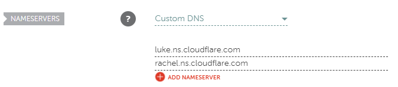
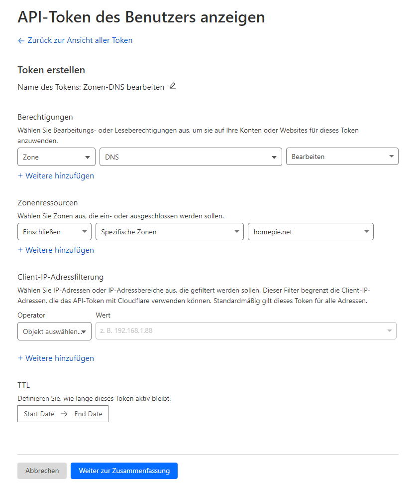

<a name="readme-top"></a>

<!-- PROJECT LOGO -->
<br />
<div align="center">
  <a href="https://github.com/arsonite/homepie">
    
  </a>

<h1 align="center">homepie</h3>
  <p align="center">
    This is the platform that powers all of my self-hosted web-apps
    <br />
    ·
    <a href="https://github.com/arsonite/homepie/issues">Report Bug</a>
    ·
    <a href="https://github.com/arsonite/homepie/issues">Request Feature</a>
  </p>
</div>

<!-- TABLE OF CONTENTS -->
<summary>Table of Contents</summary>
<ol>
  <li><a href="#deployment">Deployment</a></li>
  <li><a href="#troubleshooting">Troubleshooting</a></li>
  <li><a href="#contributing">Contributing</a></li>
  <li><a href="#license">License</a></li>
  <li><a href="#contact">Contact</a></li>
</ol>

<p align="right">(<a href="#readme-top">back to top</a>)</p>

### Built With

-   [![React][React.js]][React-url]
-   [![TypeScript][TypeScript]][TypeScript-url]
-   [![Redis][redis]][redis-url]
-   [![Celery][celery]][celery-url]
-   nginx (reverse proxy), Cloudflare (DNS), Let's Encrypt (TLS)

<p align="right">(<a href="#readme-top">back to top</a>)</p>

<!-- DEPLOYMENT -->

## Deployment

```
browser ─► Cloudflare DNS ─► router (80/443) ─► nginx ─┬─ homepie.net           landing page (client/build)
                                                       ├─ lockkliye.homepie.net ─► 127.0.0.1:8101
                                                       └─ <app>.homepie.net     ─► see nginx/conf.d/00-homepie-apps.conf
                         every request is checked first by the auth server (FastAPI, 127.0.0.1:8888)
```

All scripts are in [`cli/build-scripts`](cli/build-scripts) and can be run from anywhere. Needs Ubuntu 22.04, `node` and
`pnpm`.

### Production, fresh server

```bash
cli/build-scripts/setup-cloudflare-credentials     # Cloudflare API token (see "DNS setup" below)
cli/build-scripts/setup-periodic-cloudflare-ddns   # DNS records follow the public IP
cli/build-scripts/install-ssl                      # wildcard certificate for homepie.net + *.homepie.net
cli/build-scripts/install-nginx                    # nginx + firewall

cli/build-scripts/install-auth-server              # /var/lib/homepie, python venv, encryption key
cli/build-scripts/manage-users add <name>          # without a user nobody can log in
cli/build-scripts/start-client-prod                # build client, install nginx config, start auth server, health check
```

Router: forward **TCP 80 and 443** to the server (`192.168.2.134`, pinned by `modify-netplan`).

**Update** after a `git pull`: `cli/build-scripts/deploy` (or only `deploy client`, `deploy nginx`, `deploy auth`).

### Development

```bash
cli/build-scripts/install-client        # once
cli/build-scripts/start-client-dev      # http://localhost:5173, also starts the auth server (dev mode). Ctrl+C stops both
```

Dev mode needs a user too (`manage-users add <name>`). The login works on the dev origin only, not on subdomains.

### Auth server and users

```bash
cli/build-scripts/start-auth-server --detach    # background, log: /var/lib/homepie/run/auth-server.log
cli/build-scripts/start-auth-server             # foreground (--dev: auto-reload, cookies for plain http)
cli/build-scripts/stop-auth-server
cli/build-scripts/manage-users add|passwd|delete|list [name]
```

-   Nothing starts at boot. After a reboot run `start-auth-server --detach`; until then nginx answers `500`.
-   User changes apply immediately. Changing a password logs that user out everywhere.
-   Users live in `/var/lib/homepie/users.json` (scrypt hashes, additionally encrypted with
    `/var/lib/homepie/secrets/users.key`). **Back up that key**, without it the users are unreadable.
-   Tests: `pip install -r server/requirements/auth-test.txt && python -m pytest server`.

### How the login works

-   The lockscreen asks for the username, then the password (`Esc` goes back; on a phone tap the logo to open the
    keyboard). One request to `POST /api/auth/login` follows.
-   The session is the cookie `homepie_session` (`HttpOnly`, `Secure`, `Domain=.homepie.net`), valid on `homepie.net`
    and all subdomains. 72 h idle / 30 days max. nginx checks it for **every** request via `auth_request`:
    unauthenticated visitors are redirected to `https://homepie.net/login` (from an app with `?app=<name>`).
-   Apps get the user in the header `X-Homepie-User` and never see the session cookie. They must listen on
    `127.0.0.1` only.
-   3 wrong passwords in a row (the 3 hearts) **delete the user**. Re-create it with `cli/build-scripts/manage-users add <name>`. Change the limit with `HOMEPIE_AUTH_MAX_FAILED_ATTEMPTS` in `.env`. Careful: anyone who knows a username can delete it this way.
-   5 failed logins per client lock login for 15 minutes.

### Configuration

[`.env.template`](.env.template) defines all settings; the scripts copy it to the git-ignored `.env` on first use and
never overwrite your values (precedence: environment > `.env` > `DEFAULT_*`).

Runtime data of every project lives in `/var/lib/<project>` (`homepie`, `lockkliye`, `teatype`), never in the repo:
`run/` (pids, logs, sessions), `secrets/` (mode 700), `tmp/`. `setup-data-dirs [project|all]` creates them.

### Adding an app

1. Let it listen on `127.0.0.1:<port>`.
2. Add `<name> 127.0.0.1:<port>;` to [`nginx/conf.d/00-homepie-apps.conf`](nginx/conf.d/00-homepie-apps.conf).
3. Add a tile in [`client/src/apps/registry.ts`](client/src/apps/registry.ts).
4. `cli/build-scripts/deploy`

No DNS or certificate change needed (wildcard). Unknown subdomains return `404` (after login).

### DNS setup (once)

<details>
<summary>Namecheap → Cloudflare, API token, DDNS, certificate</summary>

1. **Nameservers**: add `homepie.net` to Cloudflare (Free plan). At Namecheap → Domain List → Manage → Nameservers
   choose **Custom DNS** and enter the two Cloudflare nameservers; disable DNSSEC. From then on all DNS records are
   managed in Cloudflare, Namecheap's redirect, parking page and Dynamic DNS no longer work.

   

2. **API token** (one token for DDNS and the certificate): Cloudflare → My Profile → API Tokens → Create Token →
   template **Edit zone DNS** → Zone · DNS · Edit, zone `homepie.net`. Then run `setup-cloudflare-credentials`, which
   verifies it and stores it in `/etc/homepie/cloudflare.ini` (root, mode 600). Never commit it.

   

3. **DDNS**: `setup-periodic-cloudflare-ddns` installs a systemd timer (every 5 min) that keeps the A records
   `homepie.net` and `*.homepie.net` on the current public IP (check: `sudo journalctl -u homepie-ddns.service -n 20`).
   It replaces the old ddclient/Namecheap setup. The wildcard record is DNS-only (a proxied wildcard needs Enterprise);
   if you proxy `homepie.net`, set SSL/TLS to **Full (strict)**.
4. **Certificate**: `install-ssl` issues one Let's Encrypt wildcard certificate via the DNS challenge, renewal is
   automatic.

</details>

<p align="right">(<a href="#readme-top">back to top</a>)</p>

<!-- TROUBLESHOOTING -->

## Troubleshooting

Not reachable at all? Check in this order, the first failing step is the problem:

| # | Check                                                              | Healthy                                  |
| - | ------------------------------------------------------------------ | ---------------------------------------- |
| 1 | `dig +short NS homepie.net @8.8.8.8`                               | two `*.ns.cloudflare.com`                |
| 2 | `dig +short homepie.net @8.8.8.8` vs `curl -s https://api.ipify.org` | same IP                               |
| 3 | `curl -I https://homepie.net` **from mobile data**                 | `302` to `/login`                        |
| 4 | `systemctl status nginx`, `sudo nginx -t`                          | active, syntax ok                        |

Many routers have no NAT loopback, so inside the home network the domain may fail although everything works: add
`192.168.2.134 homepie.net lockkliye.homepie.net` to the hosts file or set a local DNS override. If the router's WAN IP
differs from the public IP (CGNAT), port forwarding cannot work, use a Cloudflare Tunnel.

| Symptom                                   | Cause                                                                              |
| ----------------------------------------- | ---------------------------------------------------------------------------------- |
| Namecheap parking page                    | Nameservers still at Namecheap                                                     |
| `NXDOMAIN` for a subdomain                | `*` A record missing, run `setup-periodic-cloudflare-ddns`                         |
| Connection timed out                      | Router forwarding / firewall / CGNAT                                               |
| Connection refused                        | nginx not running (`start-client-prod`)                                            |
| Certificate warning                       | Run `install-ssl` (it replaces a non-wildcard certificate)                         |
| Cloudflare 521/525/526                    | Proxied record while nginx is down, or SSL mode is not **Full (strict)**           |
| `https://192.168.2.134` closes connection | Intended, nginx only answers for `homepie.net` and its subdomains                  |
| `500` on every page                       | Auth server not running: `start-auth-server --detach`                              |
| Login always fails                        | No user yet (`manage-users list`), or a prod-mode auth server used with `start-client-dev` |
| Asked to log in again on every subdomain  | Auth server was started with `--dev`, or `HOMEPIE_AUTH_COOKIE_DOMAIN` is not `.homepie.net` |
| `429` on login                            | Too many failed attempts, wait 15 minutes                                          |
| `502` on `<app>.homepie.net`              | The app is not running on the port from `00-homepie-apps.conf`                     |
| `404` on `<app>.homepie.net`              | Subdomain missing in `00-homepie-apps.conf`                                        |

<p align="right">(<a href="#readme-top">back to top</a>)</p>

<!-- CONTRIBUTING -->

## Contributing

Contributions are what make the open source community such an amazing place to learn, inspire, and create. Any contributions you make are **greatly appreciated**.

If you have a suggestion that would make this better, please fork the repo and create a pull request. You can also simply open an issue with the tag "enhancement".
Don't forget to give the project a star! Thanks again!

1. Fork the Project
2. Create your Feature Branch (`git checkout -b feature/AmazingFeature`)
3. Commit your Changes (`git commit -m 'Add some AmazingFeature'`)
4. Push to the Branch (`git push origin feature/AmazingFeature`)
5. Open a Pull Request

<p align="right">(<a href="#readme-top">back to top</a>)</p>

<!-- LICENSE -->

## License

Distributed under GPL-3 license. See `LICENSE` for more information.

<p align="right">(<a href="#readme-top">back to top</a>)</p>

<!-- CONTACT -->

## Contact

Project Link: [https://github.com/arsonite/homepie](https://github.com/arsonite/homepie)

<p align="right">(<a href="#readme-top">back to top</a>)</p>

<!-- MARKDOWN LINKS & IMAGES -->
<!-- https://www.markdownguide.org/basic-syntax/#reference-style-links -->

[product-screenshot]: images/screenshot.png
[React.js]: https://img.shields.io/badge/React-20232A?style=for-the-badge&logo=react&logoColor=61DAFB
[React-url]: https://reactjs.org/
[TypeScript]: https://img.shields.io/badge/TypeScript-20232A?style=for-the-badge&logo=typescript&logoColor=3178C6
[TypeScript-url]: https://www.typescriptlang.org/
[redis]: https://img.shields.io/badge/redis-DC382D?style=for-the-badge&logo=redis&logoColor=EEEEEE
[redis-url]: https://redis.io/de/
[Celery]: https://img.shields.io/badge/Celery-37814A?style=for-the-badge&logo=celery&logoColor=EEEEEE
[Celery-url]: https://docs.celeryq.dev/en/stable/index.html